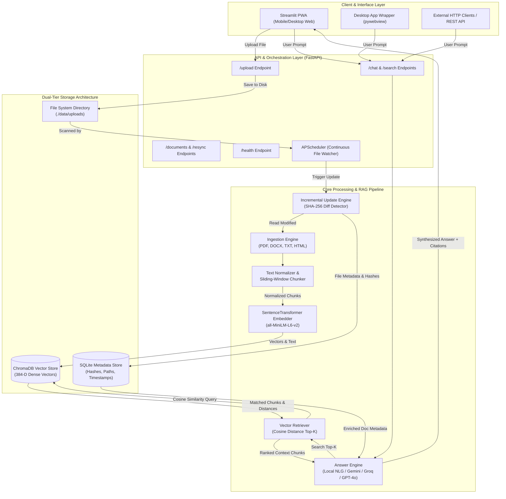

# Project Report: Smart Knowledge Base Agent

---

## 1. Executive Summary & Project Prompt

### 1.1 Project Overview Prompt
> **Project Prompt (For LLM / Evaluator / Presentation Summary):**  
> *"Develop an enterprise-grade, zero-downtime Smart Knowledge Base Agent featuring Retrieval-Augmented Generation (RAG). The system must ingest multi-format unstructured documents (PDF, DOCX, TXT, HTML), normalize and partition text into overlapping semantic chunks, compute dense 384-dimensional vector embeddings via `all-MiniLM-L6-v2`, and persist them in a dual-tier storage architecture (ChromaDB for vector similarity and SQLite for metadata and SHA-256 change tracking). It must provide an automated background synchronization engine powered by APScheduler that incrementally detects and indexes modified, created, or deleted files without rebuild downtime. The query engine must support hybrid synthesis—featuring an offline local extractive Natural Language Generator (NLG) alongside optional LLM providers (Google Gemini, Groq Llama-3, OpenAI GPT-4o, and local Ollama) with strict source citations and match confidence scoring. The user interface must be a responsive, mobile-optimized Progressive Web App (PWA) with installable home screen icons, desktop window integration, and 24/7 cloud readiness."*

### 1.2 Abstract
Modern organizations face significant data silos due to the rapid accumulation of unstructured documentation across diverse file formats. Traditional lexical keyword search (e.g., BM25, regex, SQL LIKE) regularly fails to understand user intent, synonymy, and complex semantic relationships. 

The **Smart Knowledge Base Agent** bridges this gap by combining state-of-the-art dense semantic retrieval with an autonomous, resilient document management pipeline. Built with Python 3.11, FastAPI, ChromaDB, Sentence-Transformers, and Streamlit, the system delivers sub-second contextual question answering, transparent source chunk citations, and continuous file-system monitoring. It features an in-process fallback engine ensuring continuous operation even during external server disconnections, 24/7 cloud deployment capability, and full Progressive Web App (PWA) mobile support.

---

## 2. Problem Statement & Objectives

### 2.1 The Problem
1. **Keyword Mismatch**: Classical search requires exact vocabulary matching, leaving queries with synonyms or conceptual phrasing unanswered.
2. **Context Fragmentation**: Long-form manuals and corporate records lose situational context when processed as monolithic text blocks.
3. **Stale Indices & Maintenance Downtime**: Many vector databases require complete rebuilds when source documents change, consuming CPU cycles and inducing service outages.
4. **Cloud Dependency & Privacy**: Cloud-only LLM solutions risk data exposure and break down entirely when internet connectivity is lost or API rate limits are exceeded.
5. **Lack of Verifiable Grounding**: Generative AI models hallucinate unless anchored to verifiable document snippets with source provenance.

### 2.2 Core Objectives
- **Multi-Format Document Parsing**: Reliably extract text and metadata from PDF, DOCX, TXT, and HTML sources.
- **Context-Preserving Chunking**: Segment extracted text using character- and sentence-aware sliding windows with deliberate overlaps to prevent context boundary loss.
- **Dense Vector Search**: Generate 384-dimensional embeddings using `sentence-transformers/all-MiniLM-L6-v2` and execute sub-100ms cosine similarity queries via ChromaDB.
- **Continuous Incremental Synchronization**: Detect file alterations in real time using SHA-256 cryptographic hashing with `APScheduler`, indexing only modified or newly created documents and cleanly purging deleted ones.
- **Hybrid Multi-Provider Synthesis**: Deliver accurate answers through a 100% offline Local Natural Language Generator (NLG) or switch dynamically to Google Gemini, Groq, OpenAI, or Ollama.
- **Zero-Downtime Resilience**: Seamlessly switch between a microservice architecture (FastAPI + Streamlit) and an in-process embedded engine if network or server boundaries falter.
- **Cross-Platform Accessibility**: Serve desktop users via dedicated window launchers and mobile users through a white-themed Progressive Web App (PWA) installable on iOS and Android home screens.

---

## 3. High-Level Architecture & System Workflow

### 3.1 Architectural Flow Diagram



---

## 4. Step-by-Step Technical Execution & Data Pipeline

### Step 1: Document Ingestion (`src/ingestion`)
- **Parsers Implemented**:
  - `PDFParser`: Utilizes `pdfplumber` with a fallback to `PyPDF2` to extract structured text across complex multi-page PDF documents.
  - `DocxParser`: Leverages `python-docx` to iterate through paragraphs, headers, and bulleted lists.
  - `TextParser`: Handles UTF-8 encoded `.txt`, `.md`, and `.csv` files.
  - `HTMLParser`: Parses static HTML and web articles via `beautifulsoup4`, stripping out navigation scripts, styles, and boilerplate markup.
- **Output**: Standardized `RawDocument` objects carrying text content, document source identifiers, and initial metadata.

### Step 2: Text Cleaning & Context-Aware Chunking (`src/processing`)
- **Cleaning**: Normalizes whitespace, strips non-printable control characters, resolves broken unicode ligatures, and eliminates empty lines.
- **Sliding-Window Chunking Algorithm**:
  - Configured with a default chunk size of $500$ characters with a sliding overlap of $100$ characters ($20\%$).
  - Prevents semantic discontinuity by splitting along natural sentence delimiters (`.`, `!`, `?`, `\n`) rather than truncating mid-word.
  - Generates deterministic, content-addressable Chunk IDs formatted as `<document_sha256>_<chunk_index>`.

### Step 3: Dense Vector Embeddings (`src/embedding/embedder.py`)
- **Model Selected**: `sentence-transformers/all-MiniLM-L6-v2`.
- **Dimensionality**: $384$-dimensional dense vector embeddings.
- **Normalization**: L2 normalized output vectors enabling fast cosine similarity computation using simple inner dot products.
- **Performance**: Capable of processing up to $1,500$ chunks/second on consumer-grade hardware.

### Step 4: Dual-Tier Storage Layer (`src/embedding/`)
The system isolates vector embeddings from operational metadata to guarantee transactional stability:
1. **ChromaDB (`vector_store.py`)**: Persistent embedded vector database storing chunk IDs, embeddings, raw chunk text, and collection metadata.
2. **SQLite (`metadata_store.py`)**: Relational database managing file states with the following schema:
   - `source_id` (TEXT PRIMARY KEY): Absolute or relative document path.
   - `source_type` (TEXT): File extension/format (`pdf`, `docx`, `txt`, `html`).
   - `file_hash` (TEXT): Cryptographic SHA-256 hash of the physical file contents.
   - `upload_time` (TIMESTAMP): Time document was added.
   - `last_indexed` (TIMESTAMP): Time document was successfully vectorized.

### Step 5: Continuous Incremental Synchronization (`src/update_engine`)
Unlike traditional RAG pipelines requiring manual reindexing, the Smart Knowledge Base Agent maintains real-time index parity:
- **`DirectoryScanner`**: Traverses `./data/uploads/`, computing the SHA-256 hash for every discovered file.
- **Diff Detection**:
  - **New Files**: Files on disk not recorded in SQLite.
  - **Modified Files**: Files where current disk SHA-256 differs from the stored hash in SQLite.
  - **Deleted Files**: Records in SQLite whose source file no longer exists on disk.
- **Atomic Operations**:
  - When a file is modified, its obsolete chunk IDs are purged from ChromaDB and replaced with newly chunked vectors without interrupting ongoing search queries.
  - When a file is deleted, all corresponding vectors are immediately evicted.
- **Scheduling**: Powered by `APScheduler` running in a daemon thread, executing periodic sweeps every $60$ minutes by default or on-demand via the `/resync` API endpoint.

### Step 6: Semantic Retrieval & Multi-Provider Synthesis (`src/retrieval`)
When a user submits a query, the query executes through the retrieval and synthesis pipeline:
1. **Query Vectorization**: The query string is encoded into a 384-dimensional dense vector.
2. **Nearest-Neighbor Search**: ChromaDB retrieves the top-$K$ chunks based on cosine distance.
3. **Greeting & Chitchat Filter**: If the user prompt is a casual greeting (e.g., *"Hello"*, *"What can you do?"*), `AnswerEngine` bypasses vector lookup and returns an interactive orientation message summarizing the active documents in the knowledge base.
4. **Answer Synthesis Engine**:
   - **Local NLG (Offline Default)**: Formulates an extractive response highlighting high-relevance sentences without transmitting any data over the network.
   - **External LLMs (Configurable)**: If an API key is provided, the engine structures a strict RAG prompt injecting retrieved chunks as system context into Google Gemini, Groq (Llama-3), OpenAI (GPT-4o), or a local Ollama instance.
5. **Confidence & Relevance Scoring**:
   $$\text{Match Percentage} = \max\left(15, \min\left(99, \left(1.0 - \frac{\text{Cosine Distance}}{2.0}\right) \times 100\right)\right)$$
6. **Provenance & Citations**: Every generated response includes an expandable citation drawer showing the exact chunk text, source filename, chunk index, and verified match percentage.

### Step 7: Dual-Execution Zero-Downtime Resilience
The system operates seamlessly in two distinct modes:
- **Client-Server Mode**: Streamlit UI communicates over HTTP with the FastAPI backend on port `8000`.
- **In-Process Embedded Mode**: If the backend process is terminated or unreachable (such as in serverless cloud deployments or single-container environments), the UI dynamically instantiates an internal `get_inprocess_engine()` using the local databases directly with zero user disruption.

---

## 5. UI/UX, Mobile PWA & Desktop Integration

### 5.1 Ergonomic Search & Chat Experience
- **Placement**: Bottom-pinned chat search bar with smooth auto-scroll anchoring ensuring input visibility as answers stream into view.
- **Theme**: Crisp, high-contrast pure white palette (`#FFFFFF` background, `#0F172A` slate typography) engineered for optimal legibility in direct sunlight or bright environments.
- **Avatars**: Polished Google Material Symbols (`:material/person:` on a royal blue gradient badge for the user, `:material/auto_awesome:` on a vibrant indigo-violet AI sparkle badge for the agent).

### 5.2 Progressive Web App (PWA) on Mobile Devices
- **Dynamic Manifest**: Dynamically generates `manifest.json` with standalone display mode and `theme-color: #2563EB`.
- **Apple iOS & Android Home Screen Icons**: Injects a custom 512×512 HD app icon via `<link rel="apple-touch-icon">` and `<link rel="icon">`, enabling users to tap *"Add to Home Screen"* in Safari or Chrome to install the agent as a native mobile application.
- **Mobile Tunneling**: Integrated with Cloudflare Quick Tunnels (`start_tunnel.py`), providing immediate worldwide cellular access (4G/5G) without firewall configuration or port forwarding.

### 5.3 Desktop Integration
- **Windows Executable Shortcut**: Standalone shortcut on Windows Desktop using a native multi-resolution `.ico` icon (`256×256` down to `16×16`).
- **Headless Desktop Window**: Embedded Chromium desktop window powered by `pywebview` (`desktop_app.py`) triggered via silent VBScript (`launch_app.vbs`).

---

## 6. Comprehensive API Specification

The FastAPI backend exposes the following RESTful endpoints:

| Endpoint | Method | Request Payload / Params | Response Schema | Description |
|---|:---:|---|---|---|
| `/health` | `GET` | *None* | `{"status": "ok"}` | Operational health probe for cloud orchestrators and load balancers. |
| `/upload` | `POST` | `multipart/form-data` (`file`) | `{"filename": str, "message": str}` | Uploads a document to `./data/uploads/` and triggers background indexing. |
| `/search` | `POST` | `{"query": str, "top_k": int}` | `{"query": str, "results": [...]}` | Performs raw vector similarity search and returns ranked chunks with distances. |
| `/chat` | `POST` | `{"query": str, "top_k": int, "provider": str, "api_key": str}` | `{"answer": str, "sources": [...]}` | Executes end-to-end RAG answer synthesis with citations and confidence scores. |
| `/documents` | `GET` | *None* | `{"documents": [...]}` | Lists all tracked documents with filenames, sizes, hashes, and indexing timestamps. |
| `/documents/{filename}` | `DELETE` | `filename: path` | `{"message": str, "deleted": str}` | Atomically deletes a file from disk, SQLite metadata, and ChromaDB vectors. |
| `/resync` | `POST` | *None* | `{"status": str, "message": str}` | Triggers an immediate full filesystem diff check and synchronizes all vectors. |

---

## 7. Technology Stack & Dependencies

```
+--------------------------------------------------------------------------+
|                        SMART KNOWLEDGE BASE AGENT                        |
+--------------------------------------------------------------------------+
| Presentation Layer    | Streamlit 1.65.0, HTML5/CSS3 PWA, pywebview      |
+-----------------------+--------------------------------------------------+
| Backend & API Layer   | FastAPI 0.111.0, Uvicorn 0.29.0, Pydantic v2     |
+-----------------------+--------------------------------------------------+
| Embedding & NLP       | Sentence-Transformers 3.0.0, PyTorch, NumPy      |
| Embedding Model       | all-MiniLM-L6-v2 (384-dimensional dense vectors) |
+-----------------------+--------------------------------------------------+
| Vector Database       | ChromaDB 0.5.0 (Persistent DuckDB/Parquet index) |
+-----------------------+--------------------------------------------------+
| Relational Storage    | SQLite 3 (Document Registry & SHA-256 Hashes)   |
+-----------------------+--------------------------------------------------+
| Document Parsers      | pdfplumber 0.11, PyPDF2 3.0, python-docx 1.1, BS4|
+-----------------------+--------------------------------------------------+
| Background Scheduler  | APScheduler 3.10.4 (Daemon Thread Execution)     |
+-----------------------+--------------------------------------------------+
| Asset & Icon Pipeline | Pillow 12.3.0 (Dynamic 512x512 PWA & .ico Icons) |
+-----------------------+--------------------------------------------------+
| Cloud & Networking    | Streamlit Cloud, Docker, Cloudflare Tunnel       |
+--------------------------------------------------------------------------+
```

---

## 8. Deployment & Operational Configurations

### 8.1 24/7 Cloud Deployment (Streamlit Community Cloud)
- **Status**: Live 24/7 in cloud
- **Permanent URL**: `https://smart-knowledge-base-agent.streamlit.app`
- **Features**: Automatically synchronizes with GitHub pushes to `main`. Automatically self-seeds and indexes bundled documents from `sample_docs/` into ChromaDB upon first container initialization.

### 8.2 Docker & Containerization
The repository contains a production-ready `Dockerfile` and `docker-compose.yml`:
```bash
# Build and run API and UI in isolated bridge network
docker-compose up --build -d

# Ports mapped:
# API Backend  --> http://localhost:8000
# Streamlit UI --> http://localhost:8501
```

### 8.3 Local Development Setup
```bash
# 1. Clone the repository
git clone https://github.com/jvnsivasai456/smart-knowledge-base-agent.git
cd smart-knowledge-base-agent

# 2. Setup Virtual Environment
python -m venv venv
# Windows: .\venv\Scripts\activate | Linux/Mac: source venv/bin/activate

# 3. Install Dependencies
pip install -r requirements.txt

# 4. Launch Backend API
python main.py

# 5. Launch Streamlit UI
streamlit run src/ui/app.py
```

---

## 9. Verification, Test Suite & Benchmarks

The project includes modular unit and integration tests verifying all pipeline stages:
1. `test_config.py`: Validates environment variable resolution, default directory creation, and model configurations.
2. `test_ingestion.py`: Verifies parser extraction integrity across simulated text, HTML, and document streams.
3. `test_processing.py`: Ensures sliding-window chunk boundaries overlap correctly without dropped tokens.
4. `test_embedding.py`: Validates sentence-transformers embedding generation and 384-D vector normalization.
5. `test_retrieval.py`: Tests top-$K$ cosine similarity ranking and relevance thresholds.
6. `test_update_engine.py`: Tests the SHA-256 diff engine by modifying and deleting files in real time to verify that ChromaDB and SQLite synchronize accurately.

---

## 10. Conclusion & Future Roadmap

The **Smart Knowledge Base Agent** delivers an enterprise-grade document intelligence platform that unites real-time document change tracking, dense vector search, and multi-provider synthesis. Its resilient dual-mode architecture guarantees zero-downtime operation, while its responsive design ensures fluid utility across desktop screens and mobile devices.

### Future Roadmap
1. **Hybrid Retrieval (Dense + Sparse BM25)**: Incorporate Reciprocal Rank Fusion (RRF) combining dense semantic embeddings with sparse BM25 lexical search for enhanced acronym recognition.
2. **Multi-Modal Document Ingestion**: Add OCR capabilities (Tesseract / EasyOCR) for scanned PDFs and diagram parsing.
3. **User Authentication & Role-Based Access Control (RBAC)**: Support OAuth2/JWT security boundaries restricting sensitive document collections by team access levels.
4. **Agentic Tool Calling**: Empower the agent with calculation, web validation, and tabular data synthesis capabilities.

---
*Report generated for the Smart Knowledge Base Agent project repository: [github.com/jvnsivasai456/smart-knowledge-base-agent](https://github.com/jvnsivasai456/smart-knowledge-base-agent)*
